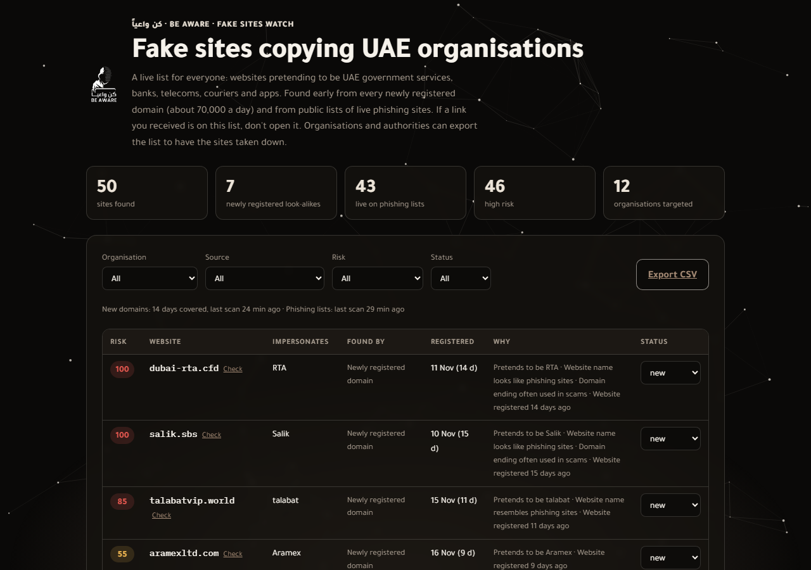
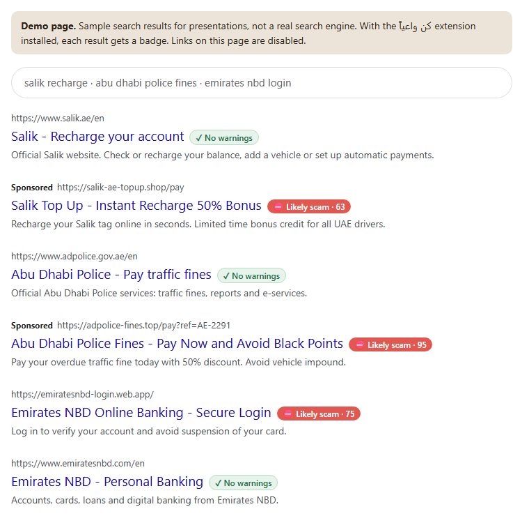

# كن واعياً Scam Shield (Be Aware)

**Protecting everyone in the UAE from fake links and websites: found the day they are registered, flagged the moment people search, click or receive them.** Free, private, Arabic and English.

Built by **team Saif Surf** (Alya Alghazal, Safiya Aljassmi, Mariam Alhammadi, Muhammad Albloshi) for the ScamShield AI hackathon (42 Abu Dhabi × Abu Dhabi Police, November 2026), challenge: *Detecting fraudulent links and websites used in cybercrimes and financial fraud.*

| | |
|---|---|
|  |  |
| **Fake sites watch.** Scans every newly registered domain (about 70,000 a day) and live phishing lists for look-alikes of 26 UAE organisations. | **Search result badges.** A browser extension marks every result and sponsored ad on Google, Bing and DuckDuckGo. |

**What it does, for whom**

| Layer | What people get | Where the code is |
|---|---|---|
| 1 · Early warning | A public list of fake sites copying UAE government services, banks, telecoms, couriers and apps, found before anyone reports them; organisations and authorities can export it to have the sites taken down | `src/brand-watch.js`, `public/watch.html` |
| 2 · At the click | Badges on search results (extension); a link and message checker website | `extension/`, `public/` |
| 3 · Awareness | The كن واعياً challenge: a game in Arabic and English for all ages | `public/game/` |

**Measured on data it never trained on** (24 Nov 2026, `npm run evaluate`, [docs/EVALUATION.md](docs/EVALUATION.md)): without any phishing list, 62 of 111 live phishing sites flagged (56%) and 0 of 64 real UAE websites wrongly flagged; 0.3 ms per link. In 14 days of newly registered domains (980,000) the watch found look-alikes such as `salik.sbs`, `dubai-rta.cfd` and `talabatvip.world`.

**Quick start** (Node.js 20 or newer)

```bash
npm install
npm test        # 26 tests
npm start       # http://localhost:8080 · /watch · /demo/search · /game
```

No keys are needed: everything above runs free on your own machine. Load the browser extension with `EXTENSION_API_BASE=http://localhost:8080 npm run build:extension`, then **Load unpacked** → `dist/extension` in `edge://extensions` or `chrome://extensions`.

Every result points people to **901** (police non-emergency line) for questions and reports, and **999** for emergencies. **© 2026 Team Saif Surf. All rights reserved.** The code is shared for evaluation in the ScamShield AI hackathon; it may not be copied or reused without the authors' written permission (see [LICENSE](LICENSE)). The datasets keep their own licences (see [data/README.md](data/README.md)).

## How a check works

```
link / message / screenshot
        │
        ├─ 1. Pattern checks (instant, no network)       public/js/url-analyzer.js
        │     look-alike domains, fake brand names, risky domain endings,
        │     IP addresses, app downloads, urgency / OTP / payment wording
        │
        ├─ 2. Short-link expansion (bit.ly etc.)         src/expand.js
        │     reads redirects only, never opens the final page,
        │     refuses internal network addresses
        │
        ├─ 3. Known phishing lists (links)                src/phish-lists.js
        │     OpenPhish + Phishing.Database, downloaded every 6 h,
        │     checked on this server (nothing sent out)
        │
        ├─ 4. Phishing-address model (links)              src/local-model/url-classifier.js
        │     trained on 369,000 phishing / genuine website names
        │
        ├─ 4b. Website age (links)                        src/domain-age.js
        │     registration date from the domain registry (RDAP)
        │
        ├─ 5. Google Safe Browsing lookup (optional key)  src/safe-browsing.js
        │     known phishing / malware lists
        │
        └─ 6. Message analysis, one of:                  src/analyze.js
              • free local model (default with no API key) src/local-analysis.js
                trained scam / not-scam classifier + checks 1-3, text only,
                runs on this server, nothing sent out, no cost
              • Claude AI (paid, set ANTHROPIC_API_KEY)    src/claude.js
                also reads screenshots, explains in its own words
```

`ANALYSIS_ENGINE=local` or `ANALYSIS_ENGINE=claude` forces one engine. Otherwise Claude is used when `ANTHROPIC_API_KEY` is set and the local model when it isn't.

### The free link checks

**Phishing lists.** On start-up and every 6 hours (`PHISH_LIST_REFRESH_HOURS`) the server downloads two free lists and keeps them in memory and in `data/feeds/` (used if a later download fails):

| List | Size | Licence |
|---|---|---|
| [OpenPhish Community feed](https://github.com/openphish/public_feed) | ~300 live phishing addresses, updated every 12 h | Non-commercial use only ([terms](https://openphish.com/terms.html)) |
| [Phishing.Database](https://github.com/Phishing-Database/Phishing.Database) active domains | ~390,000 domains | MIT |

Links are matched on this server; nothing a person submits is sent to these projects. Pages on shared sites (Google Docs, Dropbox, GitHub, link shorteners) and official brand domains only match by exact address, so one reported Google Form doesn't flag all of Google Docs. Set `PHISH_LISTS=off` to disable.

**Phishing-address model.** `npm run train:urls` trains it from `data/urls/`: the PhiUSIIL dataset (UCI, CC BY 4.0, rebuilt with `scripts/prepare-url-data.mjs`), 150,000 current phishing domains from Phishing.Database (MIT, rebuilt with `scripts/prepare-phishdb-data.mjs`), and about 120 UAE and well-known genuine sites and invented UAE look-alikes. It judges the **website name only** (never opens the page, ignores the path), because every genuine address in that dataset is a bare `https://www.` homepage. Held-out accuracy is about 87% (precision 96%, recall 83%); it scores the full name and the main domain and keeps the lower, so genuine subdomains such as `secure.etisalat.ae` aren't flagged. Official brand domains skip the model. On 35 unseen genuine sites it flagged none, and it caught 23 of 24 invented UAE look-alikes.

### Fake sites watch: early warning for everyone (`/watch`)

`src/brand-watch.js` looks for websites impersonating UAE organisations (police, ministries, UAE PASS, TAMM, Salik, RTA, utilities, banks, telecoms, couriers, delivery apps, airlines) **before** people report them:

- **Newly registered domains.** Every day it downloads the previous day's new domain names from WhoisDS (free, about 70,000 a day; the first run catches up on 14 days) and keeps names that impersonate a watched organisation. In a test on 980,000 names registered 10–23 Nov 2026 it found 7, including `salik.sbs`, `dubai-rta.cfd`, `talabatvip.world` and `aramexltd.com`, ranked at the top by risk.
- **Live phishing lists.** Sites on OpenPhish and Phishing.Database that impersonate a watched organisation (39 on 24 Nov 2026).

Matching is strict so it can scan hundreds of thousands of names: the brand must start or end a word of the name (`aramexltd`, not `elguadalajaramexican`), short brand names (du, noon, TAMM...) need a UAE or payment word next to them, and official domains are never listed. Each find gets the full link check (rules, model, lists, website age).

The public page at `/watch` lets anyone see which sites to avoid, and gives organisations and authorities what they need to have them taken down. It shows newly registered look-alikes first, then everything by risk, with filters, a CSV export for takedown requests, and a status per site (new / reviewed / reported / ignored). Changing a status needs `WATCH_TOKEN` (sent as header `x-watch-token`; the page reads it from `localStorage.watchToken`), or comes from the server machine itself when no token is set. Results are kept in `data/watch/`. Settings: `WATCH=off`, `WATCH_DAYS`, `WATCH_BRANDS`.

Certificate Transparency (crt.sh) was tried as a source but its keyword search returned incomplete results and frequent errors in Nov 2026, so it is not used.

### Website age

`src/domain-age.js` asks the domain's registry (RDAP, found through IANA's list) when the main domain was registered: under 7 days is a strong warning, under 30 days a warning. Only the main domain name is sent to the registry, never the full link. Some endings (including .ae) have no RDAP service and some registries rate-limit; then the age is shown as unknown, never guessed. Answers are cached for a week. `DOMAIN_AGE=off` disables it. For pages on shared hosting the age is the hosting platform's.

### Measured accuracy

`npm run evaluate` tests the link checker on data it was never trained on and writes [docs/EVALUATION.md](docs/EVALUATION.md). On 24 Nov 2026, **without** the phishing lists (a brand-new, unreported scam site): 62 of 111 live OpenPhish phishing addresses flagged (56%), 0 of 64 real UAE websites wrongly flagged, 0.3 ms per link. Pages hidden on hacked ordinary websites can't be recognised from the address alone; the phishing lists cover those once reported.

### The free local model

`npm run train` trains it from the labelled examples in [data/](data/README.md) and saves it to `src/local-model/model.json`, which is committed so the server works without training first. It currently learns from a public English SMS spam set and about 100 invented Arabic and English UAE-style examples. Its accuracy on held-out examples is 98% on the public set but has only been measured on 20 local examples. Before relying on it publicly, add real reported messages (with personal details removed) and retrain. It can't read screenshots: the website hides the screenshot button and asks for the text instead.

The same pattern-check file is used by the website, the server and the extension, so all three always agree.

## Run it

Requires Node.js 20 or newer.

```bash
npm install
cp .env.example .env      # then fill in the keys
npm test                  # pattern-check tests
npm start                 # http://localhost:8080
```

Without keys the site still works at no cost: pattern checks run, messages are analysed by the free local model, and Safe Browsing reports that it is unavailable.

### Keys you need

| Setting | Where to get it |
|---|---|
| `ANTHROPIC_API_KEY` | Optional, paid. console.anthropic.com → API keys (an organisation account, not a personal one). Without it the free local model is used |
| `GOOGLE_SAFE_BROWSING_KEY` | Google Cloud Console → enable **Safe Browsing API** → Credentials → API key. Restrict the key to that API and to the server's IP |
| `TRUSTED_API_KEYS` | Optional. Comma-separated keys (16+ characters) for trusted apps that call the API for many users from one server, such as a chat bot. Sent in the `x-api-key` header; they skip the per-visitor limits and the site password |

## The كن واعياً challenge (game)

The "Play the challenge" tab shows `public/game/index.html`, the original single-page كن واعياً awareness game (Arabic and English): spot the warning signs in a parcel text message and an Instagram recruitment ad. It is loaded only when the tab is opened, and can also be opened full screen at `/game/`.

This public version of the page:
- collects no data: players' names and phone numbers are not sent anywhere (the name stays in the player's browser), and there is no leaderboard or prize draw;
- has no organisation or sponsor branding, and keeps two of the original levels: the parcel text message and the recruitment ad (400 points);
- loads nothing from other websites (fonts come from `public/fonts/`).

It has its own security policy (inline scripts allowed, may only be framed by this site), set in `src/server.js`.

## Search-result badges and demo

The extension marks every result and sponsored ad on Google, Bing and DuckDuckGo results pages with a badge (no warnings / suspicious / likely scam / reported phishing site). It sends only the result links, in one request per page, to `POST /api/check-urls` (up to 25 links, 20 requests per minute per IP); search words are never sent. If the server can't be reached it falls back to the local pattern checks. Users can turn it off in the popup.

Local demo:

```bash
npm start
EXTENSION_API_BASE=http://localhost:8080 npm run build:extension
```

Then open `edge://extensions` (or `chrome://extensions`), turn on Developer mode, choose **Load unpacked** and pick `dist/extension`. Search on Bing or Google, or open http://localhost:8080/demo/search: a sample results page with genuine sites, UAE look-alike scams and one site from today's phishing list (links on it are disabled).

## Deploying on the server

To keep the whole site behind a password (for example before launch), set `SITE_PASSWORD` (and optionally `SITE_USER`, default `be-aware`); the browser then asks for them. Remove the setting to open the site. `/healthz` stays open, and apps with a trusted API key can still call the API.


1. Run `npm ci --omit=dev` and start `node src/server.js` under a process manager (systemd, PM2, or a container).
2. Put it behind the existing reverse proxy with HTTPS on the project's official domain. Set `TRUST_PROXY_HOPS` to the number of proxies so rate limits see real client IPs.
3. The server must reach these addresses outbound: `api.anthropic.com`, `safebrowsing.googleapis.com`, `graph.facebook.com`, `raw.githubusercontent.com` (phishing lists) and the URL shortener domains (for short-link expansion).
4. Health check: `GET /healthz`.
5. The server never logs submitted text, links or images, only error codes. Keep it that way if you add logging.

Endpoints:

| Method | Path | Purpose |
|---|---|---|
| `POST` | `/api/check-url` | `{ "url": "..." }` → pattern checks + short-link expansion + phishing lists + phishing-address model + Safe Browsing. 30 per minute per IP |
| `POST` | `/api/analyze` | `{ "text": "...", "image": { "mediaType": "image/png", "data": "<base64>" } }` → verdict from the local model or AI. 6 per minute per IP |
| `GET` | `/api/config` | `{ "engine": "local" \| "claude" }`, used by the page to hide AI-only features |

## Privacy

Links and messages people check are analysed on this server and are not stored; the logs hold only error codes. To find a website's age, only its main domain name (for example `example.com`, never the full link) is looked up with the domain's official registry. The phishing lists and the list of new domains are downloaded to the server, so no link anyone checks is sent to them. Search words are never sent by the extension, only result links, and only to this server.

## Publishing the extension

Build the extension with `EXTENSION_API_BASE=https://<your server> npm run build:extension` and publish `dist/extension` through the Chrome Web Store and Microsoft Edge Add-ons with an organisational account.
